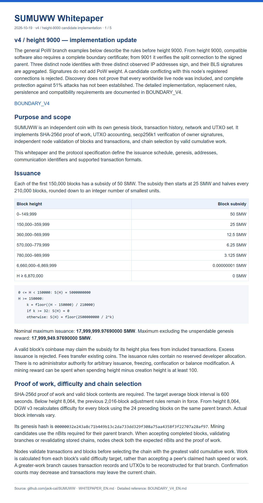
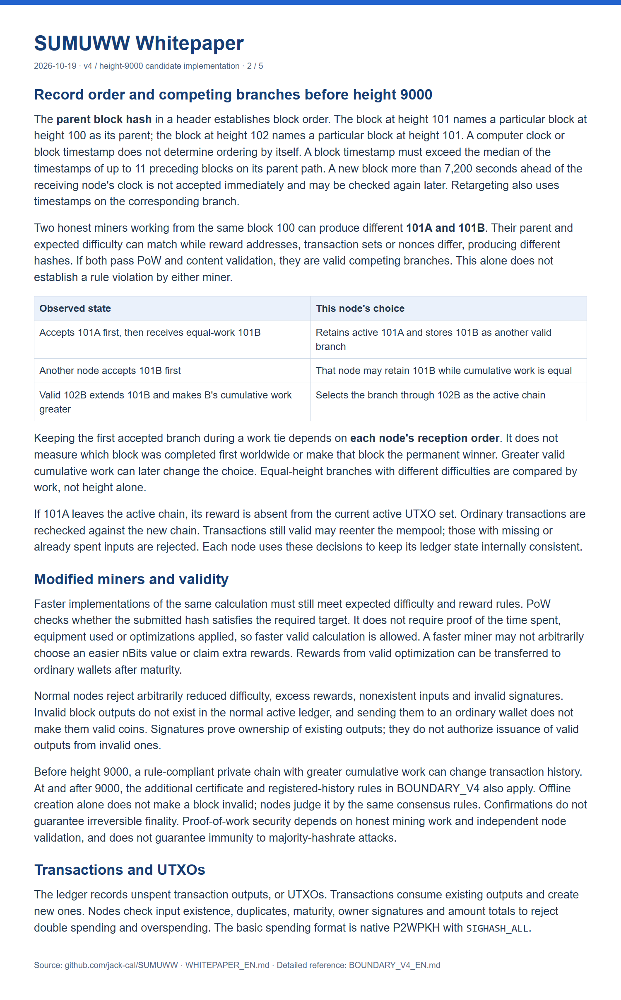
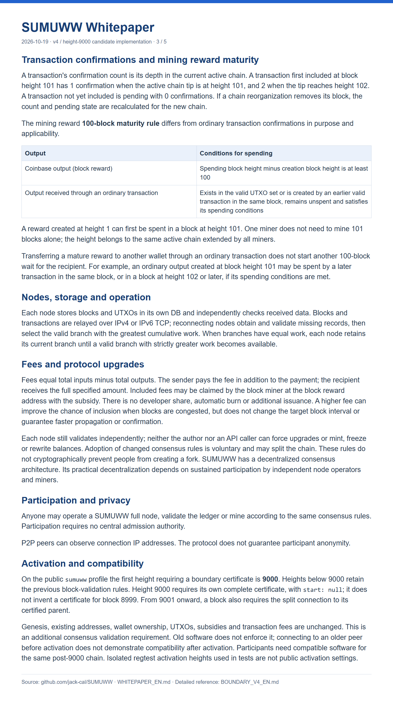
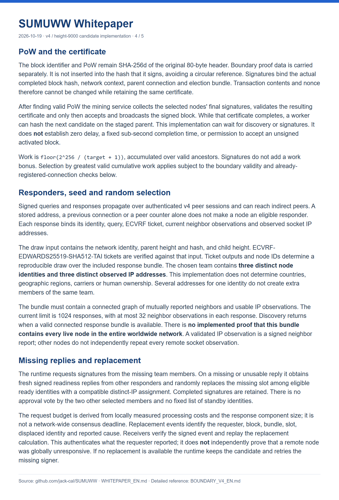
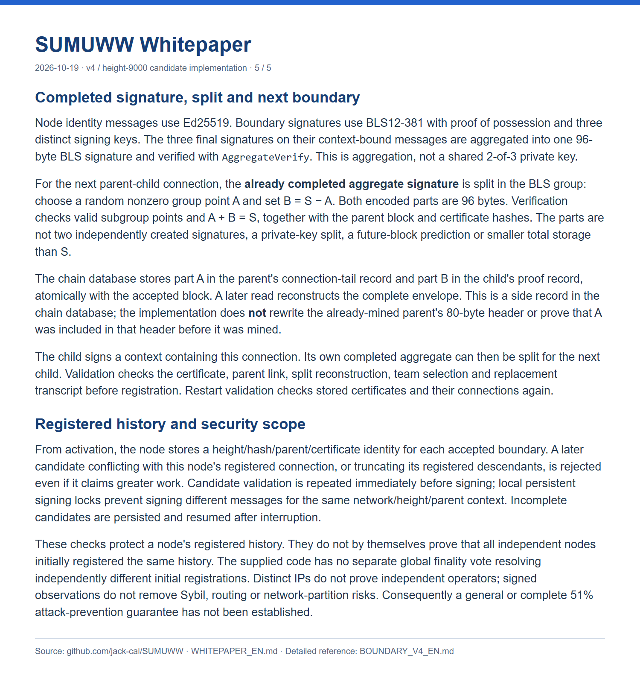

# SUMUWW (SMW)

SUMUWW is an independent SHA-256d proof-of-work coin with Windows and Android full-node, wallet and mining applications. It implements UTXO accounting, secp256k1 owner-signature verification, independent validation and chain selection by valid cumulative work subject to the active consensus rules.

## Current implementation and downloads

The [height-9000 candidate](https://github.com/jack-cal/SUMUWW/releases/tag/updates-20261019) contains **Windows 0.57.25** and **Android 0.6.75**, plus the actual implementation source ZIP and SHA-256 checksums. Its public profile requires a completed boundary certificate from block **9000**, then a split connection to the signed parent from **9001**. Earlier software does not enforce this rule. This is a candidate implementation, not a statement that the public network has activated or that every participant upgraded.

| Component | Download |
|---|---|
| Windows node / wallet / miner | [Complete Windows ZIP](https://github.com/jack-cal/SUMUWW/releases/download/updates-20261019/SUMUWW-PC-0.57.25-boundary9000-candidate.zip) |
| Android node / wallet / miner | [Signed Android APK](https://github.com/jack-cal/SUMUWW/releases/download/updates-20261019/SUMUWW-0.6.75-boundary9000-candidate.apk) |
| Implementation, tests and build instructions | [PC + Android source ZIP](https://github.com/jack-cal/SUMUWW/releases/download/updates-20261019/SUMUWW-source-0.57.25-0.6.75.zip) |
| Checksums | [SHA256SUMS.txt](https://github.com/jack-cal/SUMUWW/releases/download/updates-20261019/SHA256SUMS.txt) |
| Local read-only explorer | [Explorer 0.4.0](https://github.com/jack-cal/SUMUWW/releases/tag/explorer-v0.4.0) |

Historical releases and download records are retained. The named source ZIP contains the implementation; GitHub’s automatic “Source code” archives contain this repository’s documentation tree. The current modules are under `sumuww/`; paths using `dora/` describe older archives.

## Whitepaper and protocol

- [English whitepaper](WHITEPAPER_EN.md) · [한국어 백서](WHITEPAPER_KO.md)
- [v4 / 9000 implementation](BOUNDARY_V4_EN.md) · [v4·9000번 구현 상세](BOUNDARY_V4_KO.md)
- [Protocol specification](SUMUWW_PROTOCOL_SPEC_EN.md) · [TCP protocol](NETWORK_PROTOCOL_EN.md)
- [Genesis record](sumuww_genesis.json)

Three distinct node identities with distinct observed IPs provide BLS signatures. The completed aggregate is split for the next connection; signatures do not add a work bonus. Registered-history checks, random selection, replacement and storage are described in the implementation reference. The code does not prove worldwide inclusion of every live node or global convergence of independently different first registrations; a complete 51% attack defense has not been established.

## Consensus parameters

| Parameter | Implemented rule |
|---|---|
| PoW | SHA-256d, 80-byte block header |
| Target block interval | 600 seconds; actual intervals vary |
| Difficulty before 8064 | Adjustment every 2016 blocks |
| Difficulty from 8064 | DGW v3, previous 24 blocks on the parent branch |
| Boundary activation | Public height 9000; parent split connection from 9001 |
| TCP | Versions 1–4; boundary messages require v4 |
| Chainwork | Greatest valid cumulative work, subject to active boundary / registered-history validation; no signature-weight bonus |
| Nominal maximum issuance | 17,999,999.97690000 SMW |
| Excluding unspendable genesis reward | 17,999,949.97690000 SMW |
| Subsidy | 50 SMW for heights 0–149,999; then 25 SMW, halved every 210,000 blocks in integer smallest units |
| Smallest unit | 0.00000001 SMW |
| Reward maturity | Spending height minus creation height ≥ 100 |
| Spending | Native P2WPKH / SIGHASH_ALL, secp256k1 ECDSA |
| Address prefix | `sumuww` |
| Genesis | `00000032e243a8c71b449b13c2da733dd329f308a75aa4358f3f22707a28af97` |

Included transaction fees may be claimed by the miner with the subsidy. Fees transfer existing coins and do not increase issuance. The issuance rules have no reserved developer allocation. The official application’s GPU/ASIC selection unlocks at verified height 12000; this setting does not establish control over other miners’ hardware.

## Update checks

Windows has visible **Check for updates** and **GitHub** buttons. Android’s update button reads the same [GitHub version manifest](updates.json). Both compare numeric versions in the background and open the selected GitHub release page when requested. Update failures retain a direct GitHub fallback. Installation remains a user action.

## Operation and verification

Windows: extract the whole ZIP and keep its included files and `_internal` folder together. Android: update with the signed APK over the existing application; do not uninstall or clear data. Wallet keys, recovery words and passwords stay private. Preserve separate boundary signing state with the node database.

Connected peers count current node connections, not saved addresses, unique people or active miners. A working IPv6 socket or emulator test does not prove reachability through every mobile carrier. The 2026-10-19 battery-recovery check passed six stop/manual-restart cycles across Korean and vertical Mongolian on the 0.6.74 emulator build, then three Korean cycles on the signed 0.6.75 APK. The earlier failure was caused by an unhandled system permission dialog in the test fixture; battery production code did not require a change. The physical Samsung phone was updated in place to 0.6.75, and its update button fetched GitHub information and opened the expected release in the GitHub app. Included tests and source are project-run evidence, not an independent audit or proof of public activation.

Explorer 0.4.0 reads a selected synchronized node database and serves a local page at `http://127.0.0.1:8770`. It is not a publicly hosted explorer and does not synchronize the node, access wallet keys, mine or submit payments.

## Whitepaper images

The following pages are rendered from the current English whitepaper; [render verification](whitepaper-render-verification.json) records source and image hashes.

