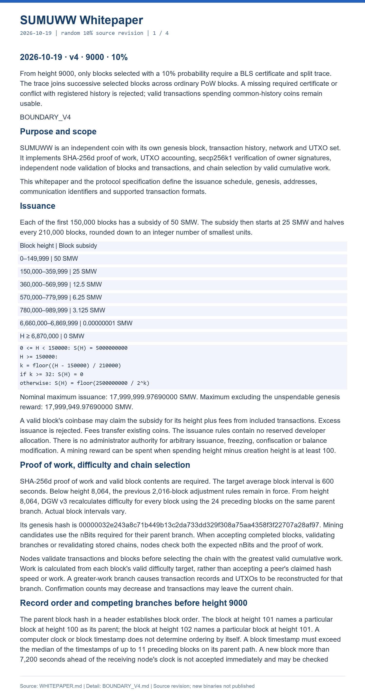
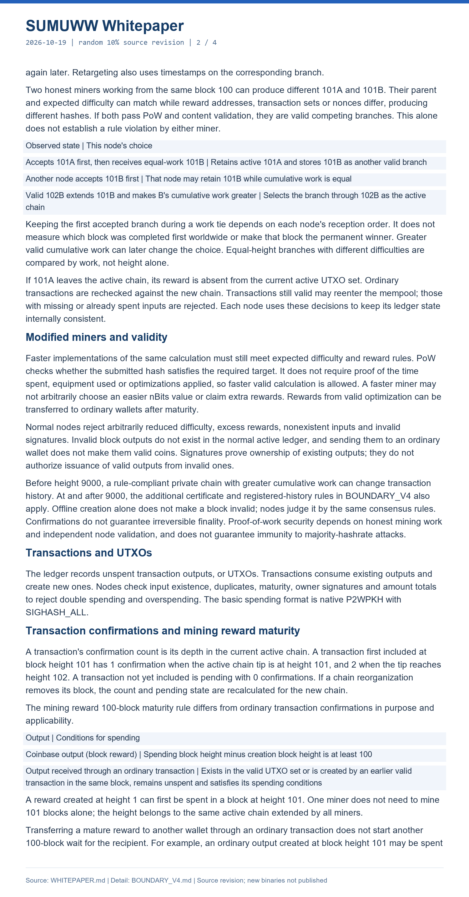
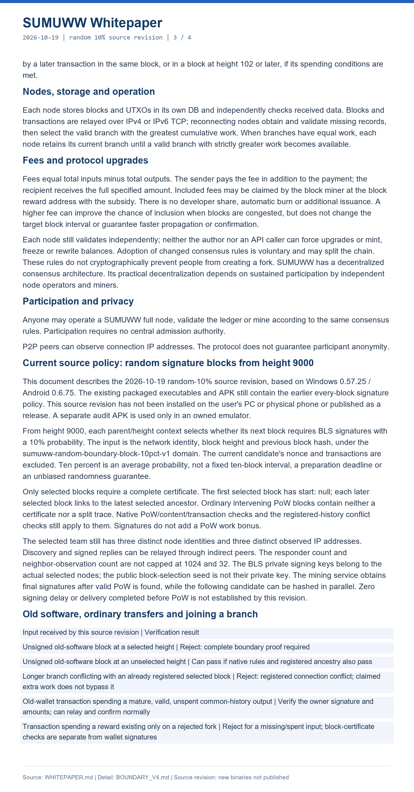
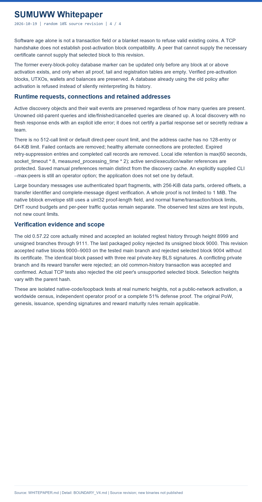

# SUMUWW (SMW)

SUMUWW is an independent SHA-256d proof-of-work blockchain with Windows and Android node, wallet and mining applications.

## Components and downloads

| Component | Application | Published version | Downloads and instructions |
|---|---|---|---|
| **PC** | Windows full node, wallet and miner | **0.57.27** | [Open PC section](PC/README.md) |
| **Android** | Android full node, wallet and CPU miner | **0.6.77** | [Open Android section](Android/README.md) |
| **Wallet** | Standalone Android wallet | **1.0.7** | [Open Wallet section](Wallet/README.md) |
| **Explorer** | Local block explorer for Windows | **0.4.2** | [Open Explorer section](Explorer/README.md) |
| **P2P** | Native desktop peer-to-peer exchange development | No published release | [Open P2P section](P2P/README.md) |

Each section lists its matching application, implementation source, checksums and installation instructions. Component version numbers are independent.

[English whitepaper](WHITEPAPER_EN.md) · [Protocol](SUMUWW_PROTOCOL_SPEC_EN.md) · [BLS/v4](BOUNDARY_V4_EN.md) · [All releases](https://github.com/jack-cal/SUMUWW/releases)

The named source ZIPs contain the implementations and tests. GitHub's automatic repository source archives contain this documentation repository. Historical releases retain their original files and download records.

## Block-signature linkage

From height **9000**, each parent/height context selects a signature-required block with **10% probability**, not a fixed ten-block interval. Three distinct node identities with distinct observed IPs provide BLS signatures; their aggregate is split and linked to the most recent selected ancestor. Ordinary intervening blocks retain native PoW and transaction checks. Registered-history conflicts are rejected. Signatures do not add a work bonus: valid cumulative PoW governs selection among eligible candidates.

Final signatures are collected after valid PoW is found, before registration and propagation. The implementation does not establish key delivery before block discovery, zero signing latency, worldwide responder coverage/convergence, or complete resistance to 51% attacks. Distinct IPs do not prove distinct people or geographic regions.

## Connection and compatibility changes

This update fixes disconnects caused by delayed optional address replies and by the previous v4 hello format. A delayed duplicate is ignored without importing hints; incompatible signing policies remain outside the current BLS signing pool. Native transport compatibility does not bypass selected-block proof validation.

Large proofs use authenticated multipart transport and improved response processing. Default direct-peer and signature-relay request count limits have been removed. Active queries are retained; idle requests and failed discovered contacts are cleaned up. Frame, transaction, block and per-peer traffic rules remain separate.

Existing valid common-history coins remain spendable. An old-version peer cannot supply a selected block without its required proof. Rewards existing only on a rejected fork cannot be spent on the accepted chain. Pre-9000 policy-marker migration preserves existing data when no activated records exist. Databases already using the former policy after activation are not automatically converted; preserve them and obtain migration guidance.

Windows: close SUMUWW and extract the whole ZIP, keeping `_internal` and included files together. Android: install over the existing app; do not uninstall or clear data. Retain encrypted wallets, the node database and separate boundary signing state. Update checks read [updates.json](updates.json) and open the release page; installation is manual.

## Documentation

- [English whitepaper](WHITEPAPER_EN.md)
- [BLS/v4 implementation](BOUNDARY_V4_EN.md)
- [Current source and compatibility](SOURCE_REVISION.md)
- [Protocol specification](SUMUWW_PROTOCOL_SPEC_EN.md) · [TCP protocol](NETWORK_PROTOCOL_EN.md)
- [Genesis record](sumuww_genesis.json) · [Change log](RELEASE_NOTES.txt)

## Consensus parameters

| Parameter | Rule |
|---|---|
| PoW | SHA-256d, 80-byte header |
| Target interval | 600 seconds; actual intervals vary |
| Difficulty | DGW v3 from 8064, using the previous 24 blocks; earlier 2016-block retarget |
| BLS policy | 10% selected blocks from 9000; linkage between successive selected ancestors |
| Subsidy | 50 SMW through 149999, then 25 SMW, halving every 210000 blocks |
| Nominal maximum issuance | 17,999,999.97690000 SMW |
| Excluding unspendable genesis reward | 17,999,949.97690000 SMW |
| Reward maturity | Spending height minus creation height >= 100 |
| Smallest unit | 0.00000001 SMW |
| Wallet ownership signatures | secp256k1 ECDSA |
| Network | IPv4/IPv6 TCP; v4 carries boundary messages |

## Verification scope

For this update, 175 network regressions, four previous-v4 TCP compatibility tests and ten frozen boundary checks passed. The installed Windows app retained the same TCP connection with a six-second delayed address reply. Eight actual external peer identities remained connected and synchronized for about seven minutes; temporary test peers were excluded. Connection growth beyond eight remains unverified. Android 0.6.77 is signed, but physical-phone installation and testing of this exact revision remain pending. See the attached VERIFICATION.txt for the exact test scope.

The source audit passed 1181 Windows tests, 11 additional policy/lifecycle tests and 21 Android emulator tests. Numeric-height isolated tests actually mined old-version history through activation and tested native TCP block/transaction compatibility. Exact release-binary and physical-installation checks are described in the release notes. These are project-run results, not an independent security audit or proof of public-network activation.

## Whitepaper pages

Rendered from the current English whitepaper; [image source hashes](whitepaper-render-verification.json).

